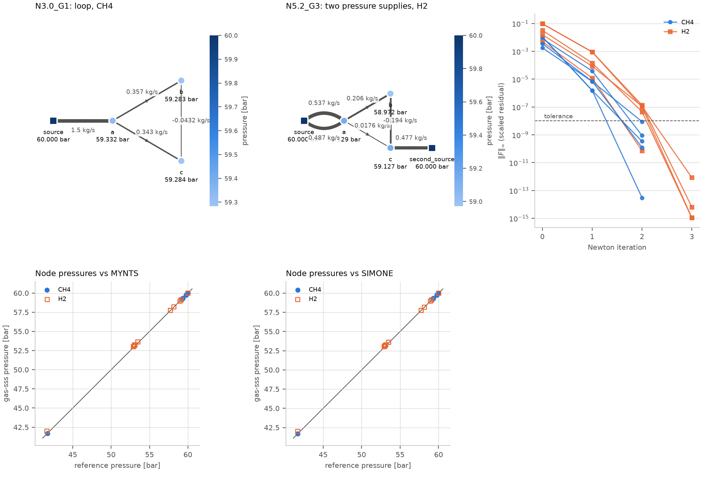

# gas-sss

Steady-state solver for isothermal gas networks (pipes, compressors, control valves, valves)
with pure methane or pure hydrogen.

Newton's method with an analytical sparse Jacobian and a sparse direct linear solver; step
lengths by backtracking on the squared L2 norm of the scaled residual; convergence when the
scaled residual infinity norm is at most 1e-8.

## Install

```bash
pip install ".[all]"
```

## Usage

```python
from gas_sss import Control, LocalPipePhysics, Network, Node, Pipe, SteadyStateSolver, gas_preset

network = Network(
    [Node("supply", pressure=60e5), Node("A", injection=0.0), Node("B", injection=-12.0)],
    [Pipe("P1", "supply", "A", length=40e3, diameter=0.6, roughness=2e-5),
     Control("CS1", "A", "B", "CS", setpoint=65e5)],
)
result = SteadyStateSolver(network, LocalPipePhysics(gas_preset("CH4"))).solve()
print(result.success, result.pressure_by_node)
```

Units are SI (Pa absolute, kg/s, m, K). `gas_preset` takes `"CH4"` or `"H2"` and uses GERG-2008
by default.

## Examples

```bash
python examples/quickstart.py --gas H2 --plot
python examples/validate_samples.py --plot validation.png
```

`validate_samples.py` runs ten verification cases (networks N1–N5, CH₄ and H₂) and compares
them with reference solutions from MYNTS and SIMONE.



## Tests

```bash
python -m unittest discover -s tests
```

## License

MIT
